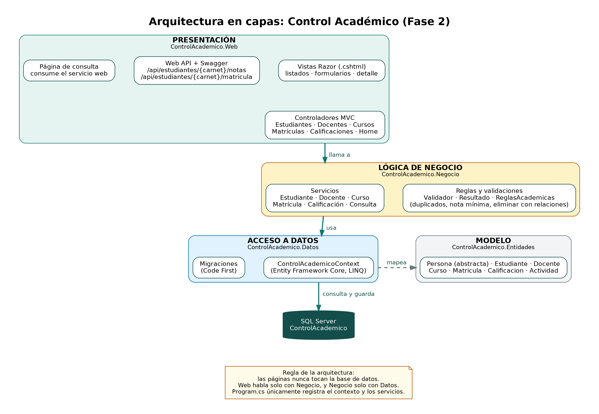
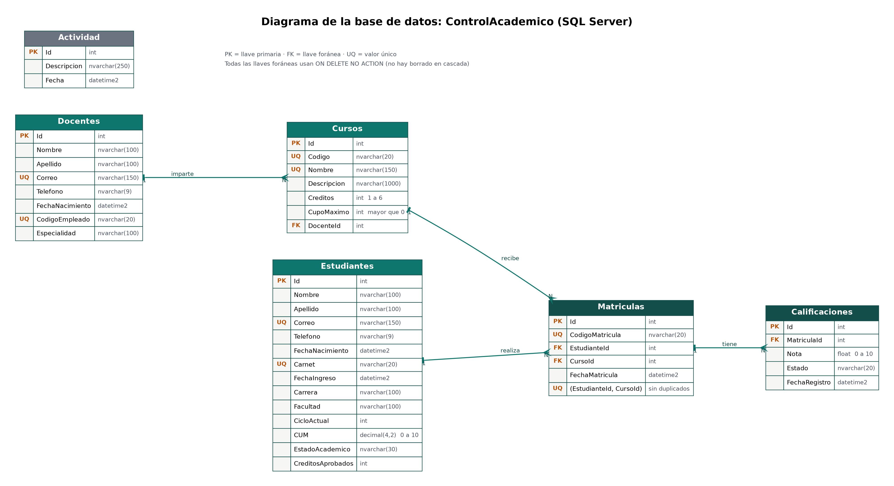

# Sistema de Control Académico

Proyecto de Cátedra, **FASE 02**

## Descripción

Sistema para el registro y control de estudiantes, docentes, cursos, matrículas y calificaciones de una institución educativa.

Este proyecto es la **ampliación de la Fase 1**, que modelaba las clases principales en C# con Programación Orientada a Objetos (herencia, clase abstracta e interfaces) y un prototipo en consola. En la Fase 2 el mismo sistema se convierte en una aplicación web conectada a una base de datos, con arquitectura en capas y un servicio web.

## Nuevas funcionalidades

- Aplicación web con **ASP.NET Core MVC** (.NET 8).
- Persistencia en **SQL Server** con **Entity Framework Core** (Code First y migraciones).
- **Arquitectura en capas**: Presentación, Lógica de negocio y Acceso a datos. Los controladores y las vistas nunca acceden a la base de datos; solo llaman a los servicios de Negocio.
- CRUD completo de Estudiantes, Docentes, Cursos, Matrículas y Calificaciones, con buscadores en los listados.
- Detalle de curso (docente, estudiantes inscritos y notas) y ficha de estudiante (cursos y notas).
- Validaciones en los formularios con mensajes en español, y manejo de errores con avisos claros (carnet o correo repetido, eliminar registros con datos relacionados, etc.).
- **Servicio web** (Web API) para consultar las notas y el estado de matrícula de un estudiante por carnet, documentado con **Swagger**, y una página de la aplicación que lo consume.
- Panel principal (dashboard) con conteos, inscritos por curso y actividad reciente.

## Tecnologías utilizadas

- C# y .NET 8
- ASP.NET Core MVC y Web API
- Entity Framework Core 8 (Code First)
- SQL Server (SSMS)
- Bootstrap 5
- Swagger (Swashbuckle)
- Git / GitHub

## Estructura del proyecto

```
ControlAcademioproyfase02/
├── ControlAcademico.sln
├── README.md
├── database/
│   ├── 01_schema.sql                 (crea la base de datos y las 6 tablas)
│   └── 02_datos_prueba.sql           (datos de ejemplo)
├── src/
│   ├── ControlAcademico.Entidades/   (Persona, Estudiante, Docente, Curso, Matricula, Calificacion, Actividad)
│   ├── ControlAcademico.Datos/       (DbContext y migraciones de EF Core)
│   ├── ControlAcademico.Negocio/     (servicios con las reglas del sistema)
│   ├── ControlAcademico.Web/         (controladores, vistas y Web API)
│   └── ControlAcademico.Consola/     (prototipo en consola de la Fase 1)
├── wireframes/                       (wireframes de la Fase 1)
└── docs/                             (diagramas)
```

### Capas

| Capa | Proyecto | Puede llamar a |
| --- | --- | --- |
| Presentación | ControlAcademico.Web | Negocio |
| Lógica de negocio | ControlAcademico.Negocio | Datos y Entidades |
| Acceso a datos | ControlAcademico.Datos | Entidades |
| Modelo | ControlAcademico.Entidades | nadie |

La capa Web solo registra el `DbContext` al iniciar (`Program.cs`); ningún controlador ni vista lo usa. La nota mínima de aprobación (6.0) está definida una sola vez, en `ReglasAcademicas` de la capa de Negocio.

## Base de datos

Base de datos `ControlAcademico` con seis tablas: `Estudiantes`, `Docentes`, `Cursos`, `Matriculas`, `Calificaciones` y `Actividad`.

- Carnet, correo, código de empleado y código de curso son únicos.
- Una matrícula es única por estudiante y curso.
- El CUM y las notas deben estar entre 0 y 10; los créditos de un curso, entre 1 y 6.
- No se usa eliminación en cascada: un estudiante, docente, curso o matrícula con datos relacionados no se puede eliminar y el sistema muestra un mensaje claro.

## Cómo ejecutar el proyecto

**Requisitos:** .NET 8 SDK (o superior con el runtime 8), SQL Server o SQL Server Express, SSMS y Visual Studio 2022 o superior.

1. Clonar el repositorio:

   ```bash
   git clone https://github.com/susivalle693-wq/ControlAcademicoproyfase02.git
   ```

2. Abrir `ControlAcademico.sln` con Visual Studio.

3. Ajustar la cadena de conexión `Default` en `src/ControlAcademico.Web/appsettings.json` con el servidor de SQL Server del equipo. Por defecto usa `Server=localhost` con autenticación de Windows. Si cada quien usa otro servidor, puede dejar su propia cadena en `appsettings.Development.json`, que no se sube al repositorio.

4. Crear la base de datos con **una** de estas dos opciones (no usar las dos sobre la misma base):

   - **Con migraciones de EF Core:**

     ```bash
     dotnet ef database update --project src/ControlAcademico.Datos --startup-project src/ControlAcademico.Web
     ```

   - **Con el script SQL:** abrir `database/01_schema.sql` en SSMS y ejecutarlo.

5. (Opcional) Cargar datos de ejemplo ejecutando **una sola vez** `database/02_datos_prueba.sql` en SSMS: 3 docentes, 10 estudiantes, 5 cursos, 15 matrículas, 12 calificaciones y 5 actividades.

6. Ejecutar la aplicación web:

   ```bash
   dotnet run --project src/ControlAcademico.Web
   ```

   Por defecto se abre en `https://localhost:7010` (o `http://localhost:5082`).

El prototipo de la Fase 1 sigue disponible:

```bash
dotnet run --project src/ControlAcademico.Consola
```

## Servicio web

La documentación interactiva está en `/swagger` (por ejemplo, `https://localhost:7010/swagger`).

| Método | Ruta | Descripción |
| --- | --- | --- |
| GET | `/api/estudiantes/{carnet}/notas` | Datos del estudiante, cursos con nota y estado, y promedio |
| GET | `/api/estudiantes/{carnet}/matricula` | Indica si el estudiante está matriculado y en qué cursos |

Si el carnet no existe, ambos devuelven **404** con un mensaje en JSON. Con los datos de prueba se puede probar con el carnet `AB253001`.

Además hay endpoints CRUD para cada módulo bajo `/api/estudiantes`, `/api/docentes`, `/api/cursos`, `/api/matriculas` y `/api/calificaciones`.

La página **Consulta de estudiante** de la aplicación web consume este mismo servicio.

## Diagramas

**Arquitectura en capas**



**Base de datos**



**Diagrama de clases (Fase 1)**


## Integrantes del equipo

| Integrante | Carnet |
| --- | --- |
| Susana Nicole Valle Méndez | VM253306 |
| Alessandra Guadalupe González Burgos | GB253116 |

### Distribución del trabajo

Cada integrante desarrolló todas las capas (Datos, Negocio y Presentación) de sus módulos.

| Integrante | Responsable de |
| --- | --- |
| Susana Nicole Valle Méndez | Base de datos y migraciones, arquitectura en capas, Estudiantes, Docentes, Cursos (con su detalle) y servicio web con Swagger |
| Alessandra Guadalupe González Burgos | Matrículas, Calificaciones, dashboard con actividad reciente, diseño de la interfaz y documentación |

Repositorio: https://github.com/susivalle693-wq/ControlAcademicoproyfase02
